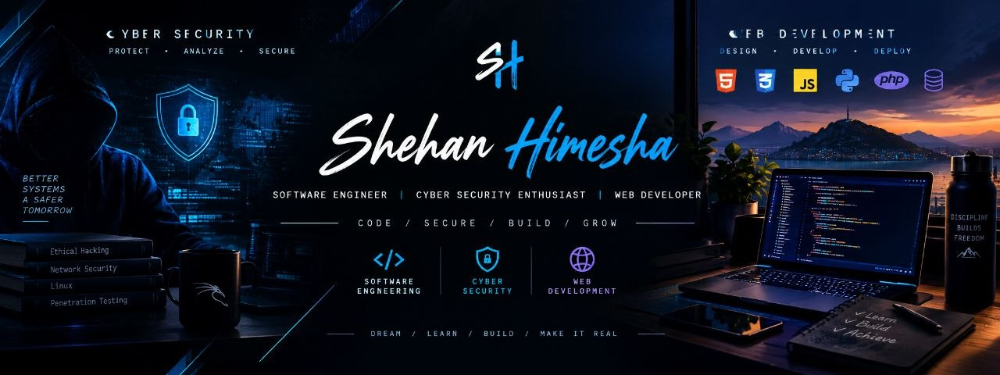

<div align="center">



</div>

<div align="center">

<!-- Animated Header with Gradient Wave -->


<!-- Dynamic Typing Animation with Multiple Lines -->
<a href="https://git.io/typing-svg">
  
</a>

<!-- Profile Views Counter with Animation -->
<p align="center">
  
  
  
</p>

<!-- Animated Divider -->


</div>

<br/>

<!-- About Me Section with Enhanced Design -->
<div align="center">

 About Me

</div>


<br/>

```typescript


const himesha: Developer = {
  name: "Shehan Himesha",
  location: "Sri Lanka 🇱🇰",
  role: "Full Stack Developer & Tech Enthusiast",
  
  languages: ["c", "Python", "JavaScript", "SQL"],
  frameworks: ["React", "Node.js"],
  databases: ["MySQL", "PostgreSQL", "Firebase"],
  tools: ["Git", "VS Code"],

  
  dailyRoutine: [
    "☕ Brew Coffee",
    "💻 Write Clean Code", 
    "🐛 Debug Like a Detective",
    "🚀 Deploy to Production",
    "📚 Learn Something New",
    "🔁 Repeat"
  ]
};
```

<div align="center">


<!-- What I'm Currently Working On -->
## 🎯 Current Focus & Goals

</div>

<table align="center">
  <tr>
    <td align="center" width="33%">
      
      <br/><br/>
      <b>🔭 Building</b><br/>
      <sub>Innovative full-stack applications<br/>with modern tech stacks</sub>
    </td>
    <td align="center" width="33%">
      
      <br/><br/>
      <b>🌱 Learning</b><br/>
      <sub>Cloud architecture, DevOps,<br/>and AI/ML technologies</sub>
    </td>
    <td align="center" width="33%">
      
      <br/><br/>
      <b>🤝 Collaborating</b><br/>
      <sub>Open source projects &<br/>building cool stuff together</sub>
    </td>
  </tr>
</table>

<br/>

<div align="center">


<!-- Tech Stack Section -->
## 💻 Tech Stack & Tools

### 🚀 Languages

<p>
  
</p>

### ⚡ Frameworks & Libraries

<p>
  
</p>

### 🗄️ Databases & Cloud

<p>
  
</p>

### 🛠️ Development Tools

<p>
  
</p>

### 🎨 Design & Other

<p>
  
</p>

</div>

<br/>

<div align="center">


<!-- GitHub Statistics Section -->
## 📊 GitHub Analytics & Performance

<!-- Main Stats Row -->
<p align="center">
  
  
</p>

<!-- Language Stats and Contribution Graph -->


<!-- Activity Graph -->
<p align="center">
  
</p>

<!-- Additional Metrics -->
<p align="center">
  
</p>

</div>

<br/>


<br/>

<div align="center">


<!-- Featured Projects Section -->
## 🎯 Featured Projects & Repositories

</div>

<div align="center">

<!-- Repository Cards Grid -->
<p align="center">
  <a href="https://github.com/shehanhimesha/testyourchoice3">
    
  </a>
 
</p>

<!-- View All Button -->
<p align="center">
  <a href="https://github.com/shehanhimesha?tab=repositories">
    
  </a>
</p>

</div>

<br/>


<br/>


<br/>

<div align="center">


<!-- Connect Section -->
## 📫 Let's Connect & Collaborate

<p align="center">
  <a href="https://github.com/shehanhimesha">
    
  </a>
  <a href="mailto:shehanhimesha0127@gmail.com">
    
  </a>

</p>

<p align="center">
  <a href="https://www.buymeacoffee.com/shehanhimesha">
    
  </a>
</p>

<!-- Contact Info Box -->
<table align="center">
  <tr>
    <td align="center">
      <b>📧 Email</b><br/>
      shehanhimesha0127@gmail.com
    </td>
    <td align="center">
      <b>🌍 Location</b><br/>
      Sri Lanka 🇱🇰
    </td>
    <td align="center">
      <b>💼 Open to</b><br/>
      Collaborations & Opportunities
    </td>
  </tr>
</table>

</div>

<br/>


<!-- Fun Facts Section -->


<br/>

<div align="center">


<!-- Support Section -->
## 💖 Support My Work

<p align="center">
  If you find my projects helpful or interesting, consider supporting me!
</p>

<p align="center">
  <a href="https://github.com/sponsors/shehanhimesha">
    
  </a>
  <a href="https://www.buymeacoffee.com/shehanhimesha">
    
  </a>
</p>

</div>

<br/>

<!-- Footer Section -->
<div align="center">


<br/><br/>

<!-- Footer Badges -->


<!-- Animated Footer Wave -->


<p align="center">
  <b>Made with 💙 and lots of ☕</b><br/>
  <sub>© 2026 Shehan Himesha. All rights reserved.</sub><br/><br/>
  <i>If you liked this profile, don't forget to ⭐ star my repositories!</i>
</p>

<!-- GitHub Stats Footer -->
<p align="center">
  
  
</p>

</div>
